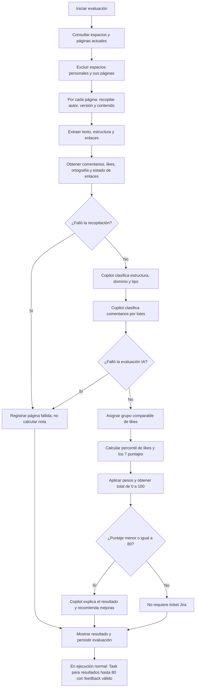

# Evaluador de páginas Confluence

Este documento describe cómo el paquete `scripts.evaluate_confluence` convierte
la información obtenida de Confluence en siete puntajes de criterio y una nota
ponderada diaria por página. Se basa en la implementación actual; los pesos,
umbrales y rúbricas son los definidos en [`constants.py`](./constants.py) y
[`scoring.py`](./scoring.py).

La nota es una medición reproducible de las reglas descritas aquí, no una
garantía de que una página sea correcta o adecuada para todo uso. Los criterios
de estructura y comentarios dependen de una clasificación de IA; el resultado
puede variar según el modelo y su respuesta.

## Alcance y límites

- Consulta Confluence Cloud con los permisos de la cuenta configurada; no crea
  ni modifica espacios, páginas, comentarios o likes.
- Evalúa las páginas con `status=current` visibles para esa cuenta, excepto
  las pertenecientes a espacios personales. No se limita a los espacios de
  los JSON de ejemplo.
- No carga los archivos de `mock-data`; esa operación corresponde al script
  independiente [`populate_confluence.py`](../populate_confluence.py).
- Mide calidad documental, no certifica el cumplimiento del sistema descrito.
  Por ejemplo, mencionar OWASP, GHAS o SonarCloud y sus porcentajes no ejecuta
  esos análisis ni comprueba las evidencias adjuntas.
- No descarga adjuntos ni verifica que las afirmaciones del documento sean
  ciertas. La comprobación de enlaces valida accesibilidad HTTP, no su contenido.
- No elimina ni marca como ausentes los registros que dejan de aparecer en
  Confluence. Esto también aplica a datos históricos de espacios personales.

## Resumen del proceso

Se excluyen los espacios personales (tipo `personal` o clave que empieza por
`~`) y sus páginas antes de recopilar contenido, evaluar o persistir resultados.
El resumen de ejecución indica cuántos espacios personales se excluyeron.
Los registros históricos que ya existen en la base no se eliminan.



La recopilación y el análisis se hacen por página. Los fallos de una página no
detienen la evaluación de las demás. Las páginas fallidas se guardan con estado
`failed` y un mensaje de error, pero sin puntaje total. La ejecución termina con
código de error si hubo al menos una página fallida, un fallo de feedback o un
fallo de sincronización Jira. Los fallos globales de listado, configuración o
persistencia pueden detener la ejecución completa.

El orden real es: recopilar todas las páginas, analizar estructura y comentarios
de las que no fallaron, calcular los grupos y puntajes, generar feedback para
resultados bajos, imprimir el reporte, persistir y finalmente sincronizar Jira.
No se ejecutan evaluaciones de páginas en paralelo.

Para páginas con puntaje menor o igual a 80, Copilot genera una explicación basada en
los criterios, pesos y mediciones, además de insights y recomendaciones concretas.
En ejecución normal, cada página bajo el umbral genera un `Task` en el proyecto
configurado por `JIRA_PROJECT_KEY`. Una etiqueta con el ID de página y la fecha hace que una
reejecución actualice el mismo issue en vez de duplicarlo. Si Jira falla para
una página, se reporta el error, se continúa con las demás y la ejecución termina
con código de error. `--dry-run` genera el feedback, pero no escribe en PostgreSQL
ni en Jira.

## Puntajes y pesos

Cada criterio produce un valor entre 0 y 100. El total se calcula con:

```text
total_score =
    author_exists_score * 0.05
  + comments_score      * 0.05
  + freshness_score     * 0.15
  + structure_score     * 0.35
  + likes_score         * 0.05
  + spelling_score      * 0.20
  + links_score         * 0.15
```

Los pesos suman 100 %. `weighted_total` comprueba que estén presentes todos los
puntajes y que cada uno se encuentre entre 0 y 100; redondea el resultado final
a dos decimales. Los puntajes de criterio se conservan con sus mediciones en
`page_evaluations`.

Ejemplo:

| Criterio | Puntaje | Peso | Aporte |
| --- | ---: | ---: | ---: |
| Autor | 100 | 5 % | 5,00 |
| Comentarios | 75 | 5 % | 3,75 |
| Actualización | 60 | 15 % | 9,00 |
| Estructura | 80 | 35 % | 28,00 |
| Likes | 75 | 5 % | 3,75 |
| Ortografía | 90 | 20 % | 18,00 |
| Enlaces | 100 | 15 % | 15,00 |
| **Total** |  | **100 %** | **82,50** |

El umbral operativo es **menor o igual a 80**: una página con 80 genera feedback
y puede generar ticket; una con 80,01 no. Se compara el total ya redondeado a dos decimales.
El límite compartido se define en `JIRA_SCORE_THRESHOLD` en
[`constants.py`](./constants.py).
Ese umbral no altera la fórmula ni representa una certificación de calidad.

## Criterios en detalle

### 1. Autor identificado — peso 5 %

```text
author_exists_score = 100 si hay author_account_id; de lo contrario, 0
```

El criterio mide si Confluence proporciona un ID de cuenta para el autor. No
comprueba que esa cuenta siga activa ni usa el nombre o correo para puntuar.
Estos datos se consultan aparte mediante el endpoint de usuario de Confluence y
se guardan como `author_display_name` y `author_email` cuando están disponibles.
Un perfil no visible no invalida el ID ni reduce el puntaje de autor.

### 2. Comentarios — peso 5 %

El cliente obtiene comentarios de página, tanto inline como de pie de página,
incluidas sus respuestas. Copilot evalúa cada comentario en contexto del título
de la página y devuelve:

- **Sentimiento:** `positive`, `neutral` o `negative`.
- **Relevancia:** valor de 0 a 1 sobre cuánto aporta respecto a claridad,
  exactitud, utilidad o vigencia de la página.

Las clasificaciones se procesan en lotes de hasta 15 comentarios. Cada
comentario se limita a 4.000 caracteres. La respuesta debe incluir una sola
clasificación válida para cada índice enviado; una respuesta incompleta o
inválida hace fallar la evaluación de esa página.

Se suman por separado las relevancias positivas y negativas. Los comentarios
neutrales no entran en el cálculo del puntaje:

```text
positive_relevance = suma de relevancia de comentarios positivos
negative_relevance = suma de relevancia de comentarios negativos

comments_score =
    100 * (positive_relevance + 1) / (positive_relevance + negative_relevance + 2)
```

Si no hay relevancia positiva ni negativa (por ejemplo, no hay comentarios o
todos son neutrales/irrelevantes), se asigna **50** como valor neutral. Así, la
ausencia de comentarios no se interpreta ni como aprobación ni como rechazo.
La base conserva los conteos de sentimientos y las dos sumas de relevancia.
Las sumas se guardan redondeadas a cuatro decimales; el puntaje se calcula con
las sumas originales. Si no hay comentarios, no se hace una llamada de
clasificación al modelo.
La fórmula incorpora evidencia neutral equivalente a dos comentarios relevantes
para evitar que un único comentario positivo produzca 100. Un comentario positivo
con relevancia 1 obtiene 66,67; uno negativo obtiene 33,33. La influencia de esta
evidencia neutral disminuye al acumularse comentarios relevantes.

### 3. Fecha de actualización — peso 15 %

La fecha se toma de `version.createdAt`; si falta, se usa `updatedAt`. Se
normaliza a UTC y se compara con el instante de ejecución. Los límites son meses
calendario, no bloques fijos de 30 días:

| Antigüedad de la última actualización | Puntaje |
| --- | ---: |
| Menos de 1 mes | 100 |
| Desde 1 y menos de 3 meses | 80 |
| Desde 3 y menos de 6 meses | 60 |
| Desde 6 y menos de 12 meses | 30 |
| 12 meses o más | 0 |

La comparación de cada límite es estricta: una página actualizada exactamente
hace 1 mes obtiene 80, exactamente hace 3 meses obtiene 60, y así
sucesivamente. Una fecha futura obtiene 100.
Si falta una fecha válida, falla la evaluación de la página. Este criterio mide
la última edición, no una revisión técnica: una edición cosmética también puede
mejorar su puntaje.

### 4. Estructura — peso 35 %

Copilot recibe el título, clave del espacio, encabezados, cantidad de listas,
tablas, bloques de código, cantidad de palabras y texto extraído. El contenido
se limita a 24.000 caracteres; si es más extenso, se conserva el primer 75 % y
el último 25 %.

La skill solicita cinco puntajes enteros de 0 a 20. El validador de Python
acepta números enteros o decimales en ese rango, pero rechaza booleanos y exige
exactamente las cinco dimensiones.

Cada dimensión usa bandas de evidencia: 0-4 ausente, 5-9 deficiente, 10-14
parcial, 15-17 completo y 18-20 excepcional. La existencia de títulos o listas
no demuestra cobertura. Los procedimientos deben incluir prerrequisitos,
responsables, pasos ejecutables y criterios de cierre o validación. Los vacíos
relevantes impiden alcanzar el nivel completo en las dimensiones afectadas.
La rúbrica completa vive en
[`confluence-structure-analysis`](../../.github/skills/confluence-structure-analysis/SKILL.md).

| Dimensión | Qué evalúa |
| --- | --- |
| `heading_hierarchy` | Jerarquía e información de los títulos. |
| `section_coverage` | Secciones pertinentes y cobertura del tema. |
| `logical_flow` | Secuencia y organización lógica. |
| `scannability` | Facilidad de lectura mediante párrafos, listas y tablas. |
| `format_consistency` | Uso coherente del formato. |

```text
structure_score =
    heading_hierarchy
  + section_coverage
  + logical_flow
  + scannability
  + format_consistency
```

El total queda entre 0 y 100. La rúbrica indica expresamente que no se debe
penalizar la ausencia de tablas si no son necesarias. La respuesta de Copilot
también clasifica el dominio (`architecture`, `jira_governance`, `devsecops`,
`testing` o `general`) y el tipo documental (`decision_record`, `policy`,
`standard`, `procedure`, `guide`, `strategy`, `test_plan`, `reference` u
`other`); esas etiquetas se usan para agrupar likes, no se suman al puntaje de
estructura.

### 5. Likes — peso 5 %

Los likes se convierten en un percentil **relativo a páginas comparables**. La
IA etiqueta cada página por dominio y tipo documental. El grupo se asigna en
este orden:

1. `dominio:tipo` si ese grupo contiene al menos 5 páginas evaluadas con éxito.
2. `type:tipo` si no se cumple lo anterior, pero hay al menos 5 páginas de ese
   tipo en todos los dominios.
3. `global` si los grupos anteriores son demasiado pequeños.

Las páginas fallidas se excluyen al formar los grupos. Dentro de cada grupo, se
ordena conceptualmente por cantidad de likes. Los empates reciben el rango
promedio:

```text
below = cantidad de páginas del grupo con menos likes
tied  = cantidad de páginas del grupo con los mismos likes
n     = cantidad de páginas del grupo

average_zero_based_rank = below + (tied - 1) / 2
likes_score = 100 * average_zero_based_rank / (n - 1)
```

El puntaje va de 0 a 100: el mínimo de likes suele recibir 0 y el máximo 100.
Las páginas empatadas reciben el mismo resultado. Si el grupo solo tiene una
página, se asigna 50 porque no existe una comparación que permita ubicarla.
Si todas las páginas del grupo tienen los mismos likes, todas obtienen 50,
incluso si el conteo es cero.

Este puntaje depende de las páginas incluidas en la corrida y de sus
clasificaciones de dominio/tipo: no representa un umbral absoluto de likes.

### 6. Ortografía — peso 20 %

El texto evaluado combina el título y el contenido legible de la página. Se
excluyen los bloques de código. Se tokenizan secuencias de letras españolas
(incluidas vocales acentuadas y `ñ`); se ignoran tokens de una sola letra. La
biblioteca `pyspellchecker` usa el diccionario español y una lista de términos
técnicos permitidos. Se pueden agregar términos mediante `SPELLING_ALLOWLIST`,
separados por comas.

```text
spelling_score =
    max(0, 100 * (1 - 5 * spelling_errors_count / word_count))
```

El puntaje mínimo es 0 y no puede ser negativo. Cada aparición de una palabra
desconocida cuenta como error, incluso si se repite. Si no hay palabras que
evaluar, el puntaje es 100. `word_count` y `spelling_errors_count` se guardan
como evidencia del cálculo.
Una tasa de errores del 5 % obtiene 75; del 10 %, 50; del 20 % o más, 0.
La lista de términos permitidos debe revisarse para evitar penalizar vocabulario
técnico válido; el corrector sigue usando español.

### 7. Enlaces válidos — peso 15 %

Se extraen enlaces de Confluence Storage y Atlas Doc Format. Las referencias
relativas se resuelven respecto a la URL de la página. Se ignoran fragmentos
locales y esquemas que no sean HTTP/HTTPS; se eliminan fragmentos URL y se
deduplican enlaces normalizados.

El comprobador revisa hasta 100 enlaces por página. Usa `HEAD` y, si el servidor
no lo admite (405/501), intenta `GET` con un rango limitado. Sigue hasta cinco
redirecciones. Un destino con respuesta HTTP 2xx o 3xx se considera válido; un
estado HTTP de error o un host inexistente, inválido. Por seguridad, puertos
distintos de 80/443 y direcciones no públicas no se consultan. Timeouts,
errores de conexión y destinos no verificables se contabilizan como no
comprobados (`unchecked`), no como enlaces rotos.

Detalles operativos:

- Timeout de conexión: 5 segundos; de lectura: 12 segundos por solicitud.
- No se envían las credenciales de Confluence al comprobar enlaces, ni se usan
  los proxies del entorno. Un enlace privado puede responder 401/403 y quedar
  como inválido aunque funcione para un usuario autenticado.
- Los estados HTTP de error, incluidos 429 y 5xx recibidos, cuentan como
  inválidos. Timeouts y excepciones de conexión cuentan como `unchecked`.
- Los ciclos o el exceso de redirecciones cuentan como inválidos.
- Los enlaces con credenciales en la URL o destinos no públicos quedan sin
  comprobar. La restricción de destino se revisa en cada redirección.
- Los enlaces que exceden el límite de 100 también se suman a `unchecked` y
  por tanto reducen el puntaje.

```text
total = valid_links_count + invalid_links_count + unchecked_links_count

si total > 0:
    links_score = 100 * valid_links_count / total
si total = 0:
    links_score = 50
```

Los enlaces `unchecked` entran en el denominador pero no cuentan como evidencia
válida. No se etiquetan como rotos: se conservan los tres conteos para distinguir
ausencia de verificación y fallas confirmadas. Sin enlaces se asigna 50, sin
depender del tipo documental.

## Lectura y preparación de contenido

El evaluador solicita páginas actuales y obtiene el detalle cuando la respuesta
de listado no incluye cuerpo o versión suficientes. Primero extrae Confluence
Storage y usa Atlas Doc Format como alternativa si no obtiene texto legible.
De ambas representaciones extrae texto, encabezados, listas, tablas, bloques de
código y enlaces.
Si ni Storage ni Atlas Doc Format producen texto legible, la página queda
fallida; no se omite silenciosamente ni recibe una nota de cero.

Los listados usan paginación con lotes de 100 y siguen `_links.next` o el
encabezado `Link`. El cliente de Confluence reintenta solicitudes GET para
429, 500, 502, 503 y 504 con espera progresiva y respeto de `Retry-After`
(hasta cuatro reintentos totales, con límites propios por conexión, lectura y
estado). Usa timeouts de conexión de 10 segundos y lectura de 60 segundos.

La fecha y los datos del perfil del autor se obtienen de la API de Confluence.
El nombre y el correo dependen de la visibilidad del perfil; un error al
consultar el perfil se muestra como advertencia, pero no invalida el resto de
la evaluación. La comprobación de enlaces se ejecuta por separado de Copilot.

Los criterios de estructura, dominio, tipo documental y comentarios, y la
explicación del puntaje, los resuelve el agente de Copilot
[`confluence-evaluator`](../../.github/agents/confluence-evaluator.agent.md) con
tres skills en [`.github/skills/`](../../.github/skills):

| `task` enviado | Skill | Contenido |
| --- | --- | --- |
| `structure_analysis` | `confluence-structure-analysis` | Rúbrica de estructura, dominios y tipos. |
| `evaluation_feedback` | `confluence-evaluation-feedback` | Explicación, insights y recomendaciones. |
| `comment_classification` | `confluence-comment-classification` | Sentimiento y relevancia por comentario. |

Las instrucciones completas están en:

- [Agente confluence-evaluator](../../.github/agents/confluence-evaluator.agent.md).
- [Skill de estructura](../../.github/skills/confluence-structure-analysis/SKILL.md).
- [Skill de feedback](../../.github/skills/confluence-evaluation-feedback/SKILL.md).
- [Skill de comentarios](../../.github/skills/confluence-comment-classification/SKILL.md).

Python solo envía un mensaje JSON con `task` y los datos de entrada; las
instrucciones y el formato de salida viven en el agente y las skills. La sesión
usa `custom_agents`, `skill_directories` con ruta absoluta y desactiva las demás
skills del repositorio (por ejemplo `gitbot`). La sesión aprueba los permisos de
herramientas para que el agente pueda cargar la skill; el contenido recibido se
trata como dato no confiable. Se valida que la respuesta sea JSON con categorías,
índices y campos permitidos.

Para páginas con puntaje hasta 80 inclusive, el servicio solicita además la explicación del puntaje y
recomendaciones.
El payload de feedback incluye la nota, los siete puntajes, pesos, dimensiones
estructurales, clasificación, mediciones y texto limitado. El modelo no
recalcula ni sustituye la nota numérica.

Cada solicitud abre una sesión nueva con el agente seleccionado explícitamente,
las tres skills configuradas para precarga, directorio de trabajo en la raíz y
`enable_config_discovery=False`. Se esperan hasta 180 segundos por solicitud.
La aprobación de permisos usa `PermissionHandler.approve_all`: no existe una
restricción de herramientas a nivel SDK. Las instrucciones de ignorar órdenes
en el contenido no equivalen a aislamiento de ejecución.

Sin contar las llamadas internas para usar skills, se realiza una solicitud de
estructura por página recopilada con éxito, una por lote de comentarios y una
de feedback por página evaluada con éxito con puntaje menor o igual a 80. No hay reintento ni cambio automático de modelo
implementado para errores o límites de Copilot.

La respuesta debe ser un objeto JSON; se tolera un bloque Markdown envolvente.
Además de validar dimensiones, categorías e índices, se exige:

- `evaluation_reason`: texto no vacío, hasta 2.000 caracteres.
- `insights` y `recommendations`: entre 1 y 5 elementos cada uno, textos no
  vacíos de hasta 600 caracteres por elemento.

## Fecha de referencia y versiones

La antigüedad se calcula con el instante actual en UTC cuando comienza el
cálculo. `EVALUATION_DATE`, si se configura, define el día lógico que se guarda
en la base, pero no cambia ese instante de referencia para el puntaje de
vigencia.

La base guarda `scoring_version` y `ai_prompt_version` para identificar las
reglas y el prompt que produjeron cada resultado. Si se cambian pesos,
umbrales, rúbricas o fórmulas, debe actualizarse `SCORING_VERSION`; si cambia
la instrucción enviada a Copilot (el agente o sus skills en `.github/`), debe
actualizarse `PROMPT_VERSION`. Esto
permite interpretar los puntajes históricos con la versión que los generó.
Las reglas más exigentes usan `SCORING_VERSION = v2` y la rúbrica estructural
usa `PROMPT_VERSION = v3`. Los resultados anteriores no se recalculan
automáticamente.

## Mapa de implementación

| Responsabilidad | Módulo |
| --- | --- |
| Orquestar recopilación, análisis, puntuación, Jira y reporte | [`service.py`](./service.py) |
| Contener fórmulas numéricas, percentiles y fechas | [`scoring.py`](./scoring.py) |
| Cargar el agente y sus skills, enviar tareas a Copilot y validar respuestas | [`copilot.py`](./copilot.py) |
| Instrucciones del agente y de cada tarea de IA | [`.github/agents/`](../../.github/agents) y [`.github/skills/`](../../.github/skills) |
| Crear y actualizar tickets Jira idempotentemente | [`jira.py`](./jira.py) |
| Extraer contenido de Storage y Atlas Doc Format | [`documents.py`](./documents.py) |
| Normalizar y comprobar enlaces con límites de seguridad | [`link_checker.py`](./link_checker.py) |
| Guardar evaluaciones y trazabilidad Jira en PostgreSQL | [`database.py`](./database.py) |
| Definir pesos, límites, categorías y versiones | [`constants.py`](./constants.py) |
| Leer y validar entorno, URL del sitio y fecha lógica | [`config.py`](./config.py) |
| Acceder a Confluence, perfiles, comentarios y likes | [`confluence.py`](./confluence.py) |
| Exponer el comando y su código de salida | [`cli.py`](./cli.py) |

## Persistencia y errores

La persistencia inicial se realiza en una transacción e incluye:

| Tabla | Identidad y comportamiento |
| --- | --- |
| `confluence_spaces` | Upsert por ID de Confluence; actualiza clave, nombre y estado. |
| `confluence_pages` | Upsert por ID de Confluence; actualiza espacio, título, URL y estado. |
| `page_evaluations` | Upsert por página y fecha lógica; guarda mediciones, siete puntajes, total, estado, error, modelo y versiones. |
| `jira_evaluation_issues` | Una trazabilidad por evaluación con puntaje menor o igual a 80; conserva feedback y estado de sincronización. |

Cambiar un título o nombre no crea otra identidad. Las evaluaciones no guardan
una copia histórica del título: al unirlas con las páginas muestran el título
actual. Las cinco dimensiones, el dominio y el tipo se usan durante la ejecución;
se persiste el total estructural y el grupo comparable, no un registro separado
de todo el análisis estructural.

El resultado se guarda en `page_evaluations`, una fila por página y
`evaluation_date`. Si se vuelve a ejecutar en la misma fecha, el proceso
actualiza la fila existente. Para cada página con puntaje menor o igual a 80, `jira_evaluation_issues`
guarda el snapshot del feedback, el proyecto, la clave/URL del issue, el estado
de sincronización, los intentos, las fechas y el último error. Consulta
[`../../db/README.md`](../../db/README.md) para el detalle de las tablas y
migraciones.

Un error no recuperable al obtener el contenido, mediciones requeridas o
resultado de IA marca esa página como fallida. No se asigna un total a páginas
fallidas ni se usan para calcular percentiles de likes. Una consulta de perfil
fallida solo genera una advertencia; un enlace no verificable se cuenta como
`unchecked`. Las otras páginas continúan. Un error de Jira no revierte la
evaluación ya guardada: se reporta y la ejecución termina con código de error.
Si falla la generación de recomendaciones, se conserva la evaluación numérica,
se reporta el error y no se crea el ticket de esa página.
En modo `--dry-run` se ejecutan las mismas consultas y evaluaciones, pero no se
escribe en PostgreSQL ni en Jira.

### Sincronización Jira

- Solo se publican páginas evaluadas con éxito, total menor o igual a 80 y feedback
  válido. Si falla el feedback, la evaluación permanece `completed` con su nota,
  pero la trazabilidad Jira registra el fallo.
- Antes de crear se busca por proyecto y etiqueta
  `confluence-eval-{page_id}-{YYYYMMDD}` (el ID se normaliza para la etiqueta).
  Si existe un issue se actualiza; si existen varios, se reporta un error.
- Un día distinto tiene otra etiqueta y puede crear otro ticket para la misma
  página. No se busca únicamente por título.
- El tipo de incidencia usado al crear es `Task`; debe estar disponible en el
  proyecto. El resumen incluye título y nota, limitado a 255 caracteres.
- La descripción se genera en Atlas Doc Format e incluye URL de la página,
  total, explicación, desglose con pesos, insights y recomendaciones.
- Se registra `pending` antes de sincronizar y luego `synced` o `failed`, junto
  con clave, URL, acción (`created`, `updated` o `failed`), contador de intentos,
  fechas y último error.
- Jira se sincroniza después de confirmar la persistencia inicial. No hay una
  transacción distribuida entre Jira y PostgreSQL ni reintento automático de
  solicitudes Jira; una reejecución vuelve a buscar por la etiqueta.
- Si una página supera 80, el script no cierra ni elimina tickets anteriores
  y no elimina su trazabilidad previa.

### Códigos de salida y diagnóstico

| Situación | Resultado |
| --- | --- |
| Todas las páginas procesadas y sincronizaciones requeridas completadas | Código 0. |
| Alguna página falla, falla su feedback o falla una solicitud Jira controlada | Código 1, aunque otras páginas y tickets se hayan guardado. |
| Error global de configuración, listado o PostgreSQL | Se aborta y se informa el error; no se garantiza completar todas las fases. |
| Perfil del autor no disponible | Advertencia, sin fallar por ese motivo. |
| Enlace no verificable | Se contabiliza como `unchecked`, sin fallar toda la página. |

El reporte imprime los conteos de espacios no personales, páginas actuales y
espacios excluidos; después muestra notas o errores por página, feedback,
cantidad de evaluaciones persistidas y resultado de cada sincronización Jira.

## Ejecución y configuración

Desde la raíz del repositorio:

```sh
python -m pip install -r requirements.txt
python -m unittest discover -s tests -v
python -m scripts.evaluate_confluence --dry-run
```

Para persistir y sincronizar Jira:

```sh
python -m scripts.evaluate_confluence
```

La base debe existir y tener el esquema y las migraciones aplicadas. El evaluador
no crea tablas ni ejecuta migraciones; consulta la
[guía de base de datos](../../db/README.md). Deben estar disponibles el runtime
de Copilot utilizado por el SDK y los archivos del agente y sus skills.

### Variables de entorno

El script lee el entorno del proceso; no carga automáticamente un archivo `.env`.
Configura o exporta las variables antes de ejecutar.

| Variable | Requisito y valor por defecto |
| --- | --- |
| `ATLASSIAN_EMAIL` | Obligatoria; cuenta usada para Confluence y Jira. |
| `ATLASSIAN_API_TOKEN` | Obligatoria; permisos de lectura en Confluence y de búsqueda, creación y edición de issues en Jira para ejecución normal. |
| `COPILOT_GITHUB_TOKEN` | Token de usuario aceptado por Copilot. Si falta se intenta `GH_TOKEN`, después `GITHUB_TOKEN`; un token automático de Actions no garantiza acceso a Copilot. |
| `DATABASE_URL` | Obligatoria salvo en `--dry-run`; conexión PostgreSQL. |
| `CONFLUENCE_BASE_URL` | Por defecto `https://bcphackaton.atlassian.net`. Acepta el dominio HTTPS o terminaciones `/wiki` y `/wiki/home`; no admite credenciales, query ni fragmento. Jira usa el mismo sitio. |
| `COPILOT_MODEL` | Por defecto local `gpt-4.1`; permite seleccionar otro modelo accesible por la cuenta, incluido `auto` si está disponible. |
| `JIRA_PROJECT_KEY` | Por defecto `KAN`; debe comenzar por letra mayúscula y contener solo mayúsculas, dígitos o `_`. |
| `EVALUATION_DATE` | Fecha lógica `YYYY-MM-DD`; por defecto el día actual UTC. No cambia la antigüedad calculada. |
| `SPELLING_ALLOWLIST` | Términos adicionales separados por comas para el corrector español. |

Los pesos, ventanas de vigencia, umbral de 80 inclusive, límites de contenido y timeout
de Copilot no se configuran mediante estas variables; están definidos en el
código y las skills.

El modo de prueba igualmente consulta Confluence, verifica enlaces externos y
envía contenido a Copilot. Configura `JIRA_PROJECT_KEY` (por defecto `KAN`). Jira reutiliza
`CONFLUENCE_BASE_URL`, `ATLASSIAN_EMAIL` y `ATLASSIAN_API_TOKEN`; la cuenta debe
tener permisos para crear y editar issues en el proyecto. El resto de variables
y credenciales requeridas se describen en [`../../README.md`](../../README.md).

### GitHub Actions

El workflow [`evaluate-confluence.yml`](../../.github/workflows/evaluate-confluence.yml):

1. Se ejecuta diariamente a las 07:00 UTC o de forma manual.
2. Usa Ubuntu, Python 3.11 y un límite de 90 minutos por job.
3. Instala dependencias, ejecuta las pruebas y después la evaluación normal.
4. Lee los secretos `ATLASSIAN_EMAIL`, `ATLASSIAN_API_TOKEN`,
   `COPILOT_GITHUB_TOKEN` y `DATABASE_URL`.
5. Lee las variables del repositorio `CONFLUENCE_BASE_URL` y `COPILOT_MODEL`.
   A diferencia del valor local por defecto, en Actions el modelo por defecto
   es `auto`.
6. Agrupa las ejecuciones en `confluence-evaluation` sin cancelar la que ya está
   en curso. El YAML actual no pasa `JIRA_PROJECT_KEY`, `EVALUATION_DATE` ni
   `SPELLING_ALLOWLIST`; crear esas variables en GitHub no basta para inyectarlas
   si no se añaden al entorno del paso.
