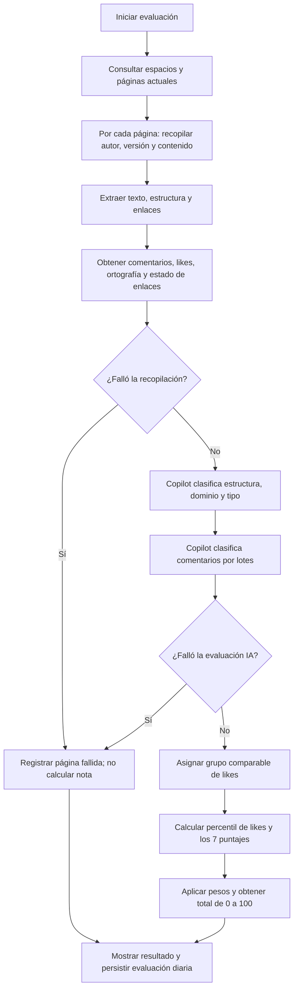

# Algoritmo de evaluación de páginas

Este documento describe cómo el paquete `scripts.evaluate_confluence` convierte
la información obtenida de Confluence en siete puntajes de criterio y una nota
ponderada diaria por página. Se basa en la implementación actual; los pesos,
umbrales y rúbricas son los definidos en [`constants.py`](./constants.py) y
[`scoring.py`](./scoring.py).

La nota es una medición reproducible de las reglas descritas aquí, no una
garantía de que una página sea correcta o adecuada para todo uso. Los criterios
de estructura y comentarios dependen de una clasificación de IA; el resultado
puede variar según el modelo y su respuesta.

## Resumen del proceso



La recopilación y el análisis se hacen por página. Los fallos de una página no
detienen la evaluación de las demás. Las páginas fallidas se guardan con estado
`failed` y un mensaje de error, pero sin puntaje total. La ejecución termina con
código de error si hubo al menos una página fallida.

## Puntajes y pesos

Cada criterio produce un valor entre 0 y 100. El total se calcula con:

```text
total_score =
    author_exists_score * 0.10
  + comments_score      * 0.10
  + freshness_score     * 0.15
  + structure_score     * 0.15
  + likes_score         * 0.05
  + spelling_score      * 0.20
  + links_score         * 0.25
```

Los pesos suman 100 %. `weighted_total` comprueba que estén presentes todos los
puntajes y que cada uno se encuentre entre 0 y 100; redondea el resultado final
a dos decimales. Los puntajes de criterio se conservan con sus mediciones en
`page_evaluations`.

Ejemplo:

| Criterio | Puntaje | Peso | Aporte |
| --- | ---: | ---: | ---: |
| Autor | 100 | 10 % | 10,00 |
| Comentarios | 75 | 10 % | 7,50 |
| Actualización | 50 | 15 % | 7,50 |
| Estructura | 80 | 15 % | 12,00 |
| Likes | 75 | 5 % | 3,75 |
| Ortografía | 90 | 20 % | 18,00 |
| Enlaces | 100 | 25 % | 25,00 |
| **Total** |  | **100 %** | **83,75** |

## Criterios en detalle

### 1. Autor identificado — peso 10 %

```text
author_exists_score = 100 si hay author_account_id; de lo contrario, 0
```

El criterio mide si Confluence proporciona un ID de cuenta para el autor. No
comprueba que esa cuenta siga activa ni usa el nombre o correo para puntuar.
Estos datos se consultan aparte mediante el endpoint de usuario de Confluence y
se guardan como `author_display_name` y `author_email` cuando están disponibles.
Un perfil no visible no invalida el ID ni reduce el puntaje de autor.

### 2. Comentarios — peso 10 %

El cliente obtiene comentarios de página, tanto inline como de pie de página,
incluidas sus respuestas. Copilot evalúa cada comentario en contexto del título
de la página y devuelve:

- **Sentimiento:** `positive`, `neutral` o `negative`.
- **Relevancia:** valor de 0 a 1 sobre cuánto aporta respecto a claridad,
  exactitud, utilidad o vigencia de la página.

Las clasificaciones se procesan en lotes de hasta 15 comentarios. Cada
comentario se limita a 4.000 caracteres. La respuesta debe incluir una sola
clasificación válida para cada índice enviado; una respuesta incompleta o
inválida hace fallar la evaluación de esa página.

Se suman por separado las relevancias positivas y negativas. Los comentarios
neutrales no entran en el cálculo del puntaje:

```text
positive_relevance = suma de relevancia de comentarios positivos
negative_relevance = suma de relevancia de comentarios negativos

comments_score =
    100 * positive_relevance / (positive_relevance + negative_relevance)
```

Si no hay relevancia positiva ni negativa (por ejemplo, no hay comentarios o
todos son neutrales/irrelevantes), se asigna **50** como valor neutral. Así, la
ausencia de comentarios no se interpreta ni como aprobación ni como rechazo.
La base conserva los conteos de sentimientos y las dos sumas de relevancia.

### 3. Fecha de actualización — peso 15 %

La fecha se toma de `version.createdAt`; si falta, se usa `updatedAt`. Se
normaliza a UTC y se compara con el instante de ejecución. Los límites son meses
calendario, no bloques fijos de 30 días:

| Antigüedad de la última actualización | Puntaje |
| --- | ---: |
| Menos de 3 meses | 100 |
| Desde 3 y menos de 6 meses | 75 |
| Desde 6 y menos de 12 meses | 50 |
| Desde 12 y menos de 24 meses | 25 |
| 24 meses o más | 0 |

La comparación de cada límite es estricta: una página actualizada exactamente
hace 3 meses obtiene 75, exactamente hace 6 meses obtiene 50, y así
sucesivamente. Una fecha futura obtiene 100.

### 4. Estructura — peso 15 %

Copilot recibe el título, clave del espacio, encabezados, cantidad de listas,
tablas, bloques de código, cantidad de palabras y texto extraído. El contenido
se limita a 24.000 caracteres; si es más extenso, se conserva el primer 75 % y
el último 25 %.

La IA asigna cinco puntajes enteros de 0 a 20:

| Dimensión | Qué evalúa |
| --- | --- |
| `heading_hierarchy` | Jerarquía e información de los títulos. |
| `section_coverage` | Secciones pertinentes y cobertura del tema. |
| `logical_flow` | Secuencia y organización lógica. |
| `scannability` | Facilidad de lectura mediante párrafos, listas y tablas. |
| `format_consistency` | Uso coherente del formato. |

```text
structure_score =
    heading_hierarchy
  + section_coverage
  + logical_flow
  + scannability
  + format_consistency
```

El total queda entre 0 y 100. La rúbrica indica expresamente que no se debe
penalizar la ausencia de tablas si no son necesarias. La respuesta de Copilot
también clasifica el dominio (`architecture`, `jira_governance`, `devsecops`,
`testing` o `general`) y el tipo documental (`decision_record`, `policy`,
`standard`, `procedure`, `guide`, `strategy`, `test_plan`, `reference` u
`other`); esas etiquetas se usan para agrupar likes, no se suman al puntaje de
estructura.

### 5. Likes — peso 5 %

Los likes se convierten en un percentil **relativo a páginas comparables**. La
IA etiqueta cada página por dominio y tipo documental. El grupo se asigna en
este orden:

1. `dominio:tipo` si ese grupo contiene al menos 5 páginas evaluadas con éxito.
2. `type:tipo` si no se cumple lo anterior, pero hay al menos 5 páginas de ese
   tipo en todos los dominios.
3. `global` si los grupos anteriores son demasiado pequeños.

Las páginas fallidas se excluyen al formar los grupos. Dentro de cada grupo, se
ordena conceptualmente por cantidad de likes. Los empates reciben el rango
promedio:

```text
below = cantidad de páginas del grupo con menos likes
tied  = cantidad de páginas del grupo con los mismos likes
n     = cantidad de páginas del grupo

average_zero_based_rank = below + (tied - 1) / 2
likes_score = 100 * average_zero_based_rank / (n - 1)
```

El puntaje va de 0 a 100: el mínimo de likes suele recibir 0 y el máximo 100.
Las páginas empatadas reciben el mismo resultado. Si el grupo solo tiene una
página, se asigna 50 porque no existe una comparación que permita ubicarla.

Este puntaje depende de las páginas incluidas en la corrida y de sus
clasificaciones de dominio/tipo: no representa un umbral absoluto de likes.

### 6. Ortografía — peso 20 %

El texto evaluado combina el título y el contenido legible de la página. Se
excluyen los bloques de código. Se tokenizan secuencias de letras españolas
(incluidas vocales acentuadas y `ñ`); se ignoran tokens de una sola letra. La
biblioteca `pyspellchecker` usa el diccionario español y una lista de términos
técnicos permitidos. Se pueden agregar términos mediante `SPELLING_ALLOWLIST`,
separados por comas.

```text
spelling_score =
    100 * (1 - spelling_errors_count / word_count)
```

El puntaje mínimo es 0 y no puede ser negativo. Cada aparición de una palabra
desconocida cuenta como error, incluso si se repite. Si no hay palabras que
evaluar, el puntaje es 100. `word_count` y `spelling_errors_count` se guardan
como evidencia del cálculo.

### 7. Enlaces válidos — peso 25 %

Se extraen enlaces de Confluence Storage y Atlas Doc Format. Las referencias
relativas se resuelven respecto a la URL de la página. Se ignoran fragmentos
locales y esquemas que no sean HTTP/HTTPS; se eliminan fragmentos URL y se
deduplican enlaces normalizados.

El comprobador revisa hasta 100 enlaces por página. Usa `HEAD` y, si el servidor
no lo admite (405/501), intenta `GET` con un rango limitado. Sigue hasta cinco
redirecciones. Un destino con respuesta HTTP 2xx o 3xx se considera válido; un
estado HTTP de error o un host inexistente, inválido. Por seguridad, puertos
distintos de 80/443 y direcciones no públicas no se consultan. Timeouts,
errores transitorios y destinos no verificables se contabilizan como no
comprobados (`unchecked`), no como enlaces rotos.

```text
checked = valid_links_count + invalid_links_count

si checked > 0:
    links_score = 100 * valid_links_count / checked
si checked = 0 y no hay enlaces unchecked:
    links_score = 100
si checked = 0 y hay enlaces unchecked:
    links_score = 50
```

Los enlaces `unchecked` no entran en el denominador cuando hay enlaces
comprobados. Por eso se deben interpretar junto con `links_score` y los tres
conteos; una proporción alta de enlaces no comprobados deja menos evidencia
para el puntaje.

## Lectura y preparación de contenido

El evaluador solicita páginas actuales y obtiene el detalle cuando la respuesta
de listado no incluye cuerpo o versión suficientes. Primero extrae Confluence
Storage y usa Atlas Doc Format como alternativa si no obtiene texto legible.
De ambas representaciones extrae texto, encabezados, listas, tablas, bloques de
código y enlaces.

La fecha y los datos del perfil del autor se obtienen de la API de Confluence.
El nombre y el correo dependen de la visibilidad del perfil; un error al
consultar el perfil se muestra como advertencia, pero no invalida el resto de
la evaluación. La comprobación de enlaces se ejecuta por separado de Copilot.

El contenido de página y comentarios se envía al GitHub Copilot SDK para los
criterios de estructura, dominio, tipo documental y comentarios. Los prompts
tratan el contenido recibido como datos no confiables, no habilitan herramientas
y validan que la respuesta sea JSON con categorías e índices permitidos.

## Fecha de referencia y versiones

La antigüedad se calcula con el instante actual en UTC cuando comienza el
cálculo. `EVALUATION_DATE`, si se configura, define el día lógico que se guarda
en la base, pero no cambia ese instante de referencia para el puntaje de
vigencia.

La base guarda `scoring_version` y `ai_prompt_version` para identificar las
reglas y el prompt que produjeron cada resultado. Si se cambian pesos,
umbrales, rúbricas o fórmulas, debe actualizarse `SCORING_VERSION`; si cambia
la instrucción enviada a Copilot, debe actualizarse `PROMPT_VERSION`. Esto
permite interpretar los puntajes históricos con la versión que los generó.

## Mapa de implementación

| Responsabilidad | Módulo |
| --- | --- |
| Orquestar recopilación, análisis, puntuación y reporte | [`service.py`](./service.py) |
| Contener fórmulas numéricas, percentiles y fechas | [`scoring.py`](./scoring.py) |
| Crear prompts de Copilot y validar respuestas | [`copilot.py`](./copilot.py) |
| Extraer contenido de Storage y Atlas Doc Format | [`documents.py`](./documents.py) |
| Normalizar y comprobar enlaces con límites de seguridad | [`link_checker.py`](./link_checker.py) |
| Guardar datos y resultados en PostgreSQL | [`database.py`](./database.py) |
| Definir pesos, límites, categorías y versiones | [`constants.py`](./constants.py) |

## Persistencia y errores

El resultado se guarda en `page_evaluations`, una fila por página y
`evaluation_date`. Si se vuelve a ejecutar en la misma fecha, el proceso
actualiza la fila existente. Se almacenan los datos observados, los siete
puntajes, el total, el estado, el modelo de IA y las versiones de prompt y
scoring. Consulta [`../../db/README.md`](../../db/README.md) para el detalle de
las tablas y migraciones.

Un error no recuperable al obtener el contenido, mediciones requeridas o
resultado de IA marca esa página como fallida. No se asigna un total a páginas
fallidas ni se usan para calcular percentiles de likes. Una consulta de perfil
fallida solo genera una advertencia; un enlace no verificable se cuenta como
`unchecked`. Las otras páginas continúan. En modo `--dry-run` se ejecutan las
mismas consultas y evaluaciones, pero no se escribe en PostgreSQL.

## Ejecución y configuración

Desde la raíz del repositorio:

```sh
python -m unittest discover -s tests -v
python -m scripts.evaluate_confluence --dry-run
```

El modo de prueba igualmente consulta Confluence, verifica enlaces externos y
envía contenido a Copilot. Variables y credenciales requeridas se describen en
[`../../README.md`](../../README.md).
